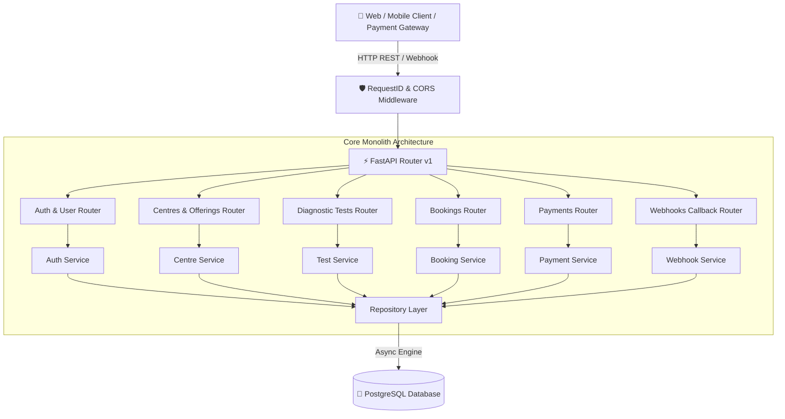
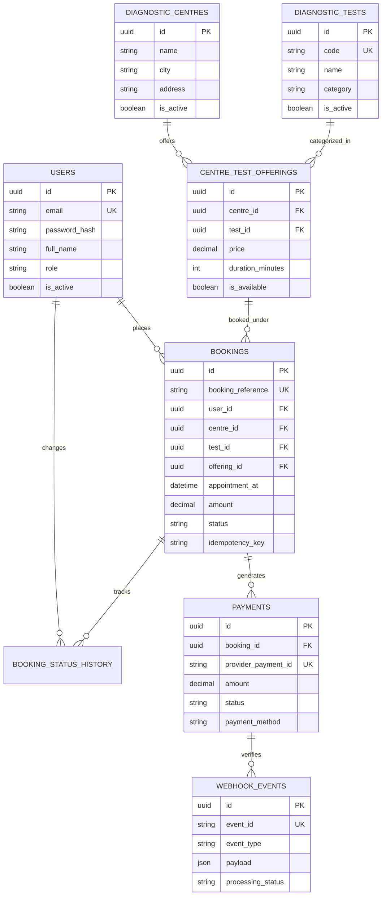

# 🏥 EVE Healthcare — Backend Engineering System

A production-grade, modular monolith backend service for diagnostic test bookings, pricing offerings, payment simulations, and idempotent webhook processing. Built with **Python 3.12+**, **FastAPI**, **PostgreSQL**, **SQLAlchemy 2.0 (Async)**, and **Alembic**.

---

## 🌟 Executive Overview

EVE Healthcare Backend is designed to handle healthcare diagnostic bookings with bank-grade financial integrity, concurrency protection, and idempotent payment webhook handling. It avoids naive CRUD anti-patterns by enforcing server-side price snapshotting, HMAC SHA256 webhook verification, strict status state machines, and correlation request ID tracing.

---

## 🏗 System Architecture



---

## 🗄 Database Entity-Relationship (ER) Diagram



---

## ⚙️ Technology Stack & Rationale

| Layer | Technology | Rationale |
| :--- | :--- | :--- |
| **Language** | Python 3.12+ | Modern type hinting, native async performance, structured concurrency. |
| **Framework** | FastAPI & Uvicorn | High performance, async route execution, automatic OpenAPI schema generation. |
| **Database** | PostgreSQL 16 | ACID transactions, row-level locking (`FOR UPDATE`), partial unique constraints. |
| **ORM** | SQLAlchemy 2.0 (Async) | Modern 2.0 declarative mappings (`Mapped[...]`), zero legacy ORM magic. |
| **Migrations** | Alembic | Version-controlled, reproducible database schema management. |
| **Security** | PyJWT & Bcrypt | Industry-standard JWT Bearer authentication and salted password hashing. |
| **Validation** | Pydantic v2 & `pydantic-settings` | Strict request/response payload validation & environment configuration. |
| **Testing** | pytest, pytest-asyncio, HTTPX | Fast, isolated unit and integration testing suite. |

---

## 📁 Repository Structure

```
eve-healthcare-backend/
├── app/
│   ├── main.py                  # FastAPI Application Entrypoint & Middleware Setup
│   ├── api/                     # REST API Controllers Layer
│   │   ├── health.py            # Health (/health) and Readiness (/ready) probes
│   │   └── v1/                  # API v1 Versioned Endpoints
│   │       ├── auth.py          # Signup, Login, Profile endpoints
│   │       ├── users.py         # User management endpoints (Admin)
│   │       ├── centres.py       # Diagnostic Centres CRUD endpoints
│   │       ├── tests.py         # Diagnostic Tests CRUD endpoints
│   │       ├── offerings.py     # Centre Test Pricing Offerings endpoints
│   │       ├── bookings.py      # Booking creation, listing, cancellation
│   │       ├── payments.py      # Payment simulation endpoints
│   │       └── webhooks.py      # Payment webhook callback endpoint
│   ├── core/                    # Core Configuration & Infrastructure
│   │   ├── config.py            # App settings (pydantic-settings)
│   │   ├── dependencies.py      # FastAPI Dependency Injection (JWT Auth, Admin check)
│   │   ├── exceptions.py        # Domain exception hierarchy
│   │   ├── logging.py           # Structured logging with correlation request IDs
│   │   ├── middleware.py       # Correlation ID & standardized error middleware
│   │   └── security.py          # Password hashing, JWT creation/decoding, HMAC signatures
│   ├── db/                      # Database Layer
│   │   ├── base.py              # DeclarativeBase & standard naming conventions
│   │   └── session.py           # Async engine & session factory
│   ├── models/                  # SQLAlchemy 2.0 ORM Models
│   │   ├── user.py              # User model
│   │   ├── diagnostic_centre.py # Centre model
│   │   ├── diagnostic_test.py   # Test model
│   │   ├── centre_test_offering.py # Centre-Test Offering join model
│   │   ├── booking.py           # Booking model with idempotency constraints
│   │   ├── booking_status_history.py # Transactional status history model
│   │   ├── payment.py           # Payment model
│   │   └── webhook_event.py     # WebhookEvent model for idempotency
│   ├── repositories/            # Data Access Layer (DB Repositories)
│   ├── schemas/                 # Pydantic v2 Validation Schemas
│   ├── services/                # Domain Business Logic Layer
│   └── utils/                   # Shared Enums & Pagination Utilities
├── alembic/                     # Alembic Migration Scripts
├── docs/                        # Architecture Decision Records (ADRs)
├── scripts/                     # Seed Data Scripts
├── tests/                       # Complete Pytest Test Suite
│   ├── conftest.py              # Pytest fixtures and async test client setup
│   ├── unit/                    # Unit tests for security, state machines, signatures
│   └── integration/             # Integration tests for Auth, Bookings, Payments, Webhooks
├── Dockerfile                   # Production Docker Container Specification
├── docker-compose.yml           # Docker Compose Orchestration (API + PostgreSQL)
├── pyproject.toml               # Project Metadata & Tooling Configurations
├── requirements.txt             # Production Dependencies
├── .env.example                 # Environment Variables Template
└── README.md                    # System Documentation
```

---

## 🔑 Key Engineering Implementations

### 1. Server-Side Price Snapshotting
Clients submit only `centre_id`, `offering_id`, and `appointment_at`. The server locks the test offering, extracts `offering.price`, and snapshots `booking.amount = offering.price`. Clients **cannot** alter prices.

### 2. Double-Booking Concurrency Protection
To prevent race conditions where two clients attempt to book the same appointment slot simultaneously:
- Row-level locking (`FOR UPDATE`) on the centre offering.
- Application-level slot validation (`check_conflicting_booking`).
- Unique indexing on `(centre_id, offering_id, appointment_at)` for active bookings.

### 3. Webhook Idempotency & HMAC Security
- Payment webhooks are validated using an HMAC SHA256 signature in `X-Webhook-Signature`.
- Every event is recorded in `webhook_events` with `UNIQUE(event_id)`.
- Re-sending the same webhook returns `status: "already_processed"` without creating duplicate payments or corrupting booking state.

### 4. Controlled Status State Machines
- **Booking Transitions**: `PENDING` ➔ `CONFIRMED`, `PENDING` ➔ `FAILED`, `PENDING` ➔ `CANCELLED`, `CONFIRMED` ➔ `CANCELLED`.
- Disallowed transitions (e.g., `CANCELLED` ➔ `CONFIRMED`, `FAILED` ➔ `CANCELLED`) raise clean 400 Bad Request errors.

---

## 🚀 Quick Start Guide

### Prerequisites
- **Docker & Docker Compose** OR **Python 3.12+** & **PostgreSQL**

---

### Option A: Running via Docker Compose (Recommended)

1. **Clone Repository & Set Environment Variables**:
   ```bash
   cp .env.example .env
   ```

2. **Start Services**:
   ```bash
   docker compose up --build
   ```
   *This automatically starts PostgreSQL, runs Alembic database migrations, populates seed data, and launches the FastAPI server on port 8000.*

3. **Access Interactive API Docs**:
   - **Swagger UI**: [http://localhost:8000/docs](http://localhost:8000/docs)
   - **ReDoc**: [http://localhost:8000/redoc](http://localhost:8000/redoc)

---

### Option B: Running Locally with Python Virtualenv

1. **Create & Activate Virtual Environment**:
   ```bash
   python -m venv .venv
   # On Windows:
   .venv\Scripts\activate
   # On Linux/macOS:
   source .venv/bin/activate
   ```

2. **Install Dependencies**:
   ```bash
   pip install -r requirements.txt
   ```

3. **Configure Environment Variables**:
   ```bash
   cp .env.example .env
   ```

4. **Run Database Migrations & Seed Data**:
   ```bash
   alembic upgrade head
   python scripts/seed.py
   ```

5. **Start Uvicorn Server**:
   ```bash
   uvicorn app.main:app --reload --port 8000
   ```

---

## 🧪 Running Test Suite

The test suite covers unit logic, security hashing, state machines, API integration, idempotency, and concurrency:

```bash
# Run full pytest suite
python -m pytest

# Run tests with verbose output and coverage
python -m pytest -v --cov=app
```

---

## 📡 API Usage & Curl Examples

### 1. User Signup
```bash
curl -X POST "http://localhost:8000/api/v1/auth/signup" \
  -H "Content-Type: application/json" \
  -d '{
    "email": "patient@example.com",
    "password": "PatientPassword123!",
    "full_name": "Alice Smith",
    "phone": "+919876543210"
  }'
```

### 2. User Login (Obtain Bearer JWT Token)
```bash
curl -X POST "http://localhost:8000/api/v1/auth/login" \
  -H "Content-Type: application/json" \
  -d '{
    "email": "patient@example.com",
    "password": "PatientPassword123!"
  }'
```

### 3. List Diagnostic Centres
```bash
curl -X GET "http://localhost:8000/api/v1/centres?city=Bangalore"
```

### 4. Create Diagnostic Booking (With Idempotency Key)
```bash
curl -X POST "http://localhost:8000/api/v1/bookings" \
  -H "Authorization: Bearer <YOUR_JWT_TOKEN>" \
  -H "Idempotency-Key: 8c7f9e4b-1234-4567" \
  -H "Content-Type: application/json" \
  -d '{
    "centre_id": "<CENTRE_UUID>",
    "offering_id": "<OFFERING_UUID>",
    "appointment_at": "2026-10-15T10:30:00Z"
  }'
```

### 5. Initiate Simulated Payment
```bash
curl -X POST "http://localhost:8000/api/v1/payments" \
  -H "Authorization: Bearer <YOUR_JWT_TOKEN>" \
  -H "Content-Type: application/json" \
  -d '{
    "booking_id": "<BOOKING_UUID>",
    "payment_method": "MOCK_SUCCESS"
  }'
```

### 6. Send Payment Webhook (Idempotent Callback)
```bash
curl -X POST "http://localhost:8000/api/v1/payments/webhook" \
  -H "Content-Type: application/json" \
  -H "X-Webhook-Signature: <HMAC_SHA256_SIGNATURE>" \
  -d '{
    "event_id": "evt_99887766",
    "event_type": "payment.updated",
    "provider_payment_id": "pay_12345678",
    "status": "SUCCESS",
    "amount": "850.00",
    "currency": "INR"
  }'
```

---

## 🔒 Security Best Practices

- **Zero Hardcoded Secrets**: All keys, passwords, and webhook secrets are loaded strictly from environment variables.
- **Constant-Time Verification**: Password verifications and HMAC SHA256 signatures use constant-time comparisons (`hmac.compare_digest`) to prevent timing attacks.
- **OWASP Compliance**: Parametrized queries via SQLAlchemy ORM protect against SQL injection; Pydantic v2 schemas reject malformed input payloads.

---

## 🔮 Future Production Improvements

1. **Distributed Caching with Redis**: Cache centre offerings and test catalogs for sub-millisecond retrieval.
2. **Background Task Queue (Celery / ARQ)**: Process email notifications and SMS appointment reminders asynchronously.
3. **Real Payment Gateway Integration**: Connect Razorpay / Stripe SDKs with actual webhook secret handling.
4. **Audit Logging & Tracing**: Integrate OpenTelemetry and Jaeger for distributed transaction tracing across services.
